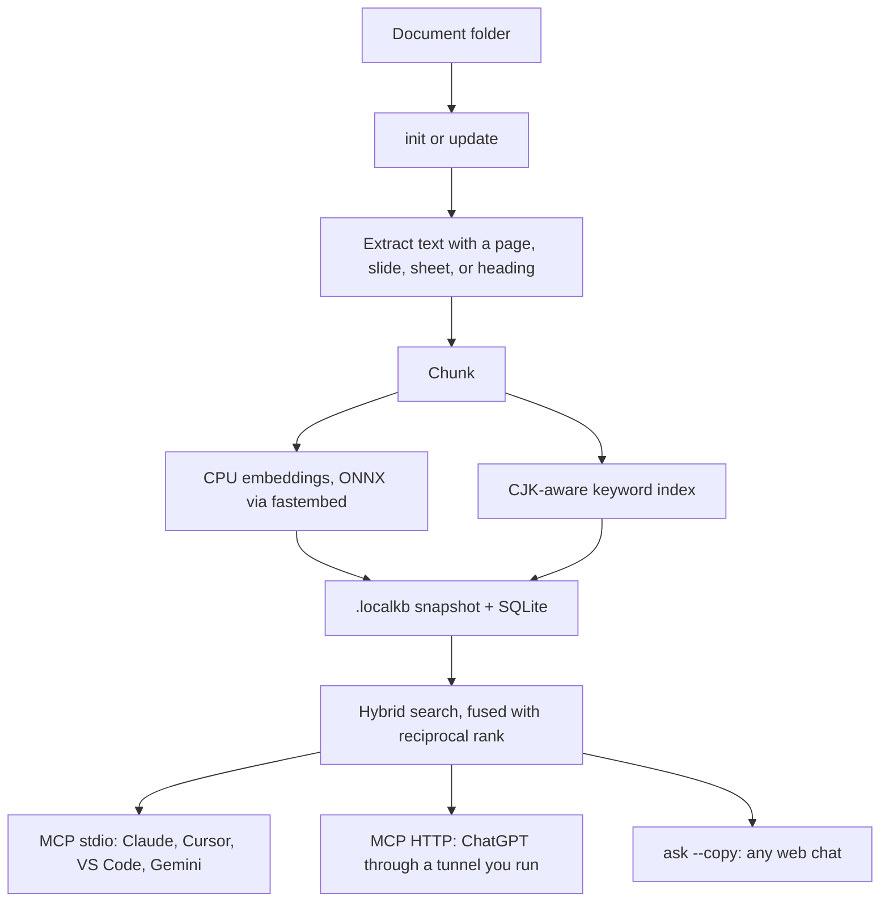

# localkb

Private, local-first knowledge base for any AI.

[](https://github.com/chinghauchu/localkb/actions/workflows/ci.yml)

localkb indexes a folder of documents on your machine and lets the assistant you already use search it. Claude Desktop, Cursor, VS Code, and Gemini CLI connect over local MCP. ChatGPT developer mode connects over streamable HTTP. Any web chat can take a cited prompt from the clipboard. There is no account, no API key, and no chat window of its own.


## Why

The useful part of a personal knowledge base is the index, not another chatbot. Your documents already live in a folder. localkb builds the index beside them, keeps it up to date when files change, and hands cited excerpts to whichever assistant you trust with that text.

The index is portable: copy the folder and `.localkb/` comes with it. Embeddings and search run locally. localkb does not upload your files.

## Quickstart

v0.1 is not published to PyPI. From a checkout of this repo:

```bash
uvx --from . localkb init ~/Documents/notes
uvx --from . localkb update ~/Documents/notes
uvx --from . localkb search "what did we decide about storage?" --folder ~/Documents/notes
```

`init` creates `~/Documents/notes/.localkb/` (SQLite index, vectors, and a snapshot of every file). `update` is safe to run often: if nothing changed, it only compares paths, sizes, and modification times. `search` prints excerpts with the file and the page, slide, sheet, or heading they came from.

To install the `localkb` command instead of calling `uvx` each time:

```bash
uv tool install --from . localkb
# or: pipx install .
```

The first `init` with the default embedder downloads a small ONNX model into your user cache (about 240 MB, once). Tests and offline smoke runs can pass `--embedder hash`, which does not download anything and is not a quality embedder.

## Commands

| Command | What it does |
| --- | --- |
| `localkb init <folder>` | Index the folder into `<folder>/.localkb/`. `--force` builds a replacement and swaps it in only after the new index succeeds. |
| `localkb update [folder]` | Reindex only what changed. Prints added, modified, deleted, renamed, and elapsed time. |
| `localkb search "q" [-k N] [--json]` | Hybrid search. `--json` prints machine-readable citations. |
| `localkb ask "q" --copy` | Build a prompt that contains the question and cited excerpts, and copy it. Prints the prompt if the clipboard is unavailable. |
| `localkb serve` | MCP over stdio. |
| `localkb serve --http --port 8765 --token …` | MCP over streamable HTTP on `/mcp`. A token is required (`--token`, `LOCALKB_TOKEN`, or `--generate-token`). |
| `localkb install claude\|cursor\|vscode\|gemini` | Merge an MCP entry into that client's config. Copies the previous file to `*.bak` first. |
| `localkb status [folder]` | File count, chunk count, model, and index size. |

`--folder` defaults to the current directory for `search`, `ask`, `serve`, and `install`. `update` and `status` take an optional positional folder.

## Connect your AI

`localkb install` records the absolute path of the folder in the client config (the config lives on this machine; MCP results do not repeat it). Move the folder, and run `install` again. Each install writes a new timestamped backup and leaves an existing `*.bak` alone. Restart the client after writing its config. Every tool is read-only: `search`, `fetch`, `list_documents`, and `status`. The server instructions tell the model to cite the file and the location on every claim.

The first index with the default embedder downloads about 240 MB of ONNX weights into `~/.cache/localkb/fastembed`. That download is per machine, not per folder.

If you run `install` from `uvx`, the config calls `uvx localkb serve` instead of the temporary interpreter. Until the package is available to `uvx`, install a stable command with `uv tool install --from <checkout> localkb` and run `install` again. The command prints that warning.

### Claude Desktop

```bash
localkb install claude --folder ~/Documents/notes
```

Writes `claude_desktop_config.json` under the Claude Desktop config directory (`~/Library/Application Support/Claude` on macOS, `%APPDATA%\Claude` on Windows, `~/.config/Claude` on Linux). Other MCP servers in the file are left in place.

Claude Code uses a different file (`.mcp.json` in the project, or `~/.claude.json`) with the same `mcpServers` shape. Copy the `localkb` entry if you want it there too.

### Cursor

```bash
localkb install cursor --folder ~/Documents/notes
```

Writes `~/.cursor/mcp.json` (`mcpServers.localkb`).

### VS Code

```bash
localkb install vscode --folder ~/Documents/notes
```

Writes the user `mcp.json` (`servers.localkb`, `type: stdio`): `~/.config/Code/User/mcp.json` on Linux, `~/Library/Application Support/Code/User/mcp.json` on macOS, `%APPDATA%\Code\User\mcp.json` on Windows.

### Gemini CLI

```bash
localkb install gemini --folder ~/Documents/notes
```

Writes `~/.gemini/settings.json` under `mcpServers`, leaving the rest of the file alone.

### ChatGPT (developer mode, streamable HTTP)

ChatGPT on the web cannot start a local process, so this path uses HTTP plus a tunnel you control.

```bash
localkb serve --http --port 8765 --token "$LOCALKB_TOKEN"
# or mint one and print it on stderr:
localkb serve --http --port 8765 --generate-token
```

HTTP mode refuses to start without a token. `--insecure-no-token` is the only exception, and only with `--host 127.0.0.1`. Any other bind address requires a token. `--host` must be the address clients send in the `Host` header; `0.0.0.0` is rejected because those checks would fail for every normal request.

The process listens on `127.0.0.1:8765` by default and prints a warning. Endpoint: `http://127.0.0.1:8765/mcp`. Health check, with no document text: `http://127.0.0.1:8765/health`.

Host and Origin are checked. A request whose `Host` is not the address you bound is rejected. A tunnel (Tailscale, SSH, cloudflared, ngrok) must present that host, for example by forwarding `Host: 127.0.0.1`. Anyone who can open the public URL and present the bearer token can read excerpts. Prefer a private network and do not publish the URL or the token.

In ChatGPT developer mode, add an MCP server at the tunnel's `/mcp` URL. Tool names `search` and `fetch` follow the deep-research shape (`id`, `title`, `url`, and `fetch` returns `text` plus `metadata`) and also include the file, page, slide, or sheet.

### Any web AI (clipboard)

```bash
localkb ask "what was the March launch plan?" --copy --folder ~/Documents/notes
```

Paste the prompt into the chat. It already contains the excerpts and asks the model to cite `[n]` with the file and location. If `pbcopy`, `wl-copy`, `xclip`, `xsel`, and `clip` are all missing, the prompt is printed instead.

## Formats

Subfolders are included. Hidden directories, `.git`, `node_modules`, virtualenvs, and `.localkb` itself are skipped. Symlinks are not followed.

| Format | Extensions | Citation |
| --- | --- | --- |
| PDF | `.pdf` | Page number (PyMuPDF) |
| Word | `.docx` | Heading path. Word page numbers depend on layout, so they are not invented. |
| Excel | `.xlsx` | Sheet name |
| PowerPoint | `.pptx` | Slide number |
| Markdown | `.md`, `.markdown` | Heading path |
| Text | `.txt` | Part number when the file is split |

Office files go through [MarkItDown](https://github.com/microsoft/markitdown). Scanned pages and legacy `.doc`, `.xls`, and `.ppt` are out of scope. A file that yields no text is recorded and reported; it is not sent anywhere.

## How it works



`init` walks the folder and writes three things under `.localkb/`:

- `index.sqlite` holds chunk text, a float32 vector per chunk, and an FTS5 keyword index.
- `snapshot.json` is the folder image: relative path, size, mtime, content hash, and the id of each chunk that came from that file.
- `meta.json` records the embedder, model, and timestamps.

`update` compares the folder to that image.

- Same path, size, and mtime: left alone, unless that file failed to parse last time. Failures are retried. A quiet folder with no failures does not hash or embed.
- Same path, different bytes: the old chunks are replaced.
- Path gone: its chunks are removed.
- A path disappears and one new path has the same content hash: treated as a rename or move. Vectors are kept and the path is rewritten. Two copies, or two files with the same hash moving at once, are not guessed; those are a delete plus an add.
- Size or mtime changed but the hash matches: only the snapshot metadata is refreshed.

Search runs vector cosine and FTS5, then fuses the two rankings with reciprocal rank fusion. Keyword indexing covers Han (simplified and traditional), Japanese kana, and Hangul. Those runs have no spaces, so each run is stored as overlapping bigrams (`知識庫` becomes `知識` and `識庫`) and padded so a mixed token matches a spaced query (`Q3營收` matches `Q3 營收`). Latin words stay whole. The default model is `sentence-transformers/paraphrase-multilingual-MiniLM-L12-v2` (384 dimensions, CPU ONNX, about 240 MB, no PyTorch). It truncates at 128 tokens, so localkb mean-pools overlapping windows before storing one vector per chunk. `--model jinaai/jina-embeddings-v2-base-zh` is a larger Chinese-English option with a long context, still via fastembed. Embeddings are requested in batches of 256, with progress on stderr.

Vectors live in the SQLite file and are scanned exactly. That stays simple and portable for a personal library. It is the wrong shape for millions of chunks.

The model weights are cached under `~/.cache/localkb/fastembed` (or `FASTEMBED_CACHE_PATH` / `LOCALKB_CACHE`). They are not copied into every folder. A copied folder still needs the same model on the next machine to embed a question; the vectors themselves travel with the folder.

## Comparison

localkb is a folder index you attach to an assistant. These projects solve a wider problem, usually by shipping their own chat application:

| | localkb | AnythingLLM | PrivateGPT | Khoj | Open WebUI | mcp-local-rag |
| --- | --- | --- | --- | --- | --- | --- |
| Runs on your machine | Yes | Yes | Yes | Yes | Yes | Yes |
| Own chat UI | No | Yes | Yes | Yes | Yes | No |
| Uses the assistant you already have | MCP, HTTP, clipboard | Its own app | Its own API and UI | Its own app | Its own app, usually in front of Ollama | MCP |
| Index travels inside the document folder | Yes | App database | App database | App database | App database | Typically a server-side index |
| Incremental update, rename detected by hash | Yes | Varies | Varies | Varies | No | Varies |
| API key required to index | No | Only if you choose a hosted model | No, if the model is local | Only if you choose a hosted model | No, if the model is local | No |

AnythingLLM, PrivateGPT, Khoj, and Open WebUI are stronger when you want a full local chat product. mcp-local-rag is the closest neighbor: an MCP server over local files. localkb adds the portable `.localkb` snapshot, hash-based renames, one installer for the common clients, a clipboard prompt, and an HTTP listener for ChatGPT.

## Privacy

Parsing, embeddings, and search run on this computer. localkb has no account and does not send document text to a service of its own. The default model is an ONNX file downloaded from Hugging Face the first time you index; the download is the model, not your documents.

An assistant receives excerpt text only when you connect one. MCP and `ask --copy` send the excerpts you retrieve into that product, under that product's own terms. Citation URLs use the `localkb:///` scheme and the path inside the folder, not a `file://` path on this machine. `status` reports counts and the model, not the absolute folder. HTTP mode serves excerpts only to a client that presents the bearer token (unless you explicitly opt into `--insecure-no-token` on `127.0.0.1`). Use a private tunnel, and do not put the listener on the public internet.

Use localkb with documents you are allowed to store, and with the assistants you are allowed to use. It is a personal index, not a way around someone else's rules.

## Development

Requires Python 3.10+ and [uv](https://docs.astral.sh/uv/).

```bash
uv sync --group dev
uv run ruff check src tests
uv run ruff format --check src tests
uv run pytest
uv run localkb init ./some-folder --embedder hash
uv run localkb search "query" --folder ./some-folder
```

CI runs ruff and pytest on Python 3.10, 3.11, and 3.12. The test suite builds a tiny PDF, DOCX, XLSX, PPTX, and Markdown corpus (English and Traditional Chinese) and does not download the embedding model.

End to end from a fresh environment, still without publishing the package:

```bash
uvx --from . localkb init ./some-folder --embedder hash
uvx --from . localkb update ./some-folder
uvx --from . localkb search "query" --folder ./some-folder
```

## Roadmap

- OCR for scans and images
- HTML, CSV, email, and legacy Office
- Ollama and other embedding providers (the `ollama` extra is reserved; calling it explains that it is not implemented yet)
- Approximate nearest neighbor when a library outgrows a full scan
- Watch mode
- Optional local reranker
- Encryption of the index at rest

Out of scope for 0.1: OCR, a chat UI, and cloud sync.

## Limitations

- Change detection trusts size and mtime, then a content hash. An edit that keeps both size and mtime is invisible until something else about the file changes.
- DOCX citations are headings, not pages.
- The default embedder truncates at 128 tokens per window. Mean-pooling covers the chunk, but it is not a long-context model.
- Vector search reads every chunk. Fine for thousands of chunks, not for a corpus that needs an ANN index.
- Password-protected and scanned files produce a skip or an empty document. There is no OCR.
- `.doc`, `.xls`, and `.ppt` are not supported.
- The Ollama extra is a stub.
- The package is not on PyPI. Install from this repo.
- HTTP mode requires a bearer token. `--insecure-no-token` works only on `127.0.0.1`. Host and Origin are validated, so a tunnel has to present the bound host.
- Clipboard support depends on a platform tool being installed.

## License

MIT. See [LICENSE](LICENSE).
